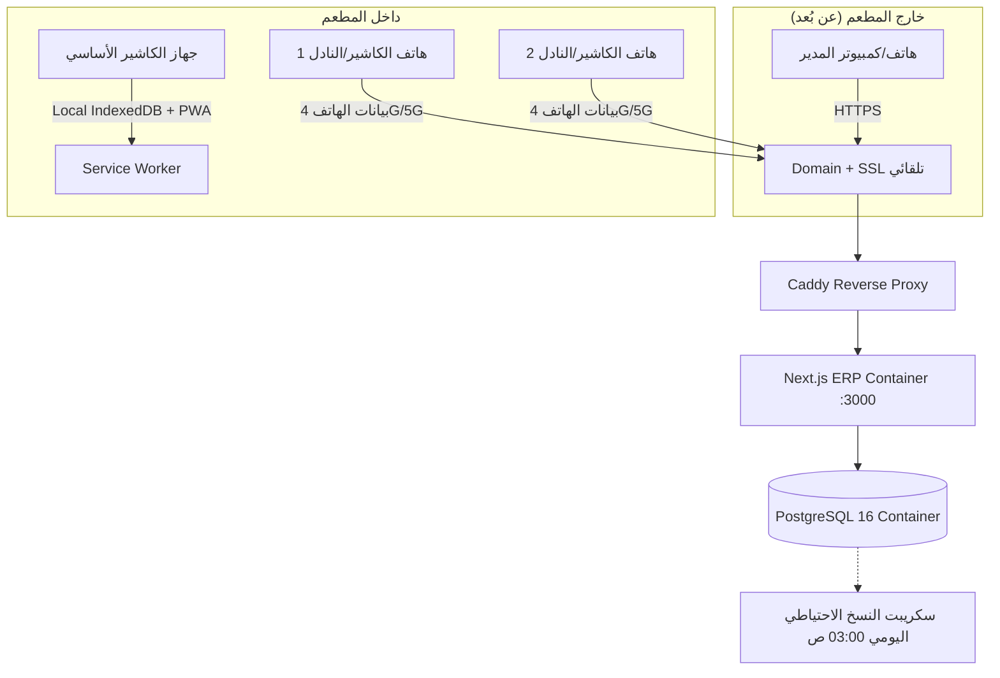

# دليل النشر السحابي والوصول عن بُعد والنسخ الاحتياطي
## Cloud Deployment, Remote Access & Backup Guide — Sheikh Al Kar ERP

يقدم هذا الدليل خطوات عملية واضحة لتشغيل نظام ERP على خادم سحابي مستقل (Cloud VPS)، مع ربط نطاق ثابت (Domain) وتفعيل شهادة أمان SSL تلقائياً، وإتاحة وصول المدير عن بُعد، واستقبال الطلبات من الهواتف المحمولة عند انقطاع الكهرباء.

---

## 1. البنية المعمارية للنشر السحابي



---

## 2. متطلبات الخادم السحابي (VPS Requirements)

* **الخادم الموصى به:** VPS بنظام Ubuntu 22.04 أو 24.04 (من Hetzner, DigitalOcean, Linode, أو Contabo).
* **المواصفات الأدنى:**
  - 2 vCPU
  - 4 GB RAM (أو 2 GB RAM + 2 GB Swap)
  - 40 GB SSD Storage
* **نطاق مخصص (Domain Name):** مثل `erp.sheikhal-kar.com` أو `pos.restaurant.com`.

---

## 3. خطوات النشر على الخادم السحابي (خطوة بخطوة)

### الخطوة 1: ربط الدومين بالخادم (DNS Configuration)
في لوحة تحكم مزود الدومين (Cloudflare, Namecheap, GoDaddy):
* أضف سجل من نوع **A Record**:
  - **Host / Name:** `erp` (أو `@` للنطاق الرئيسي)
  - **Value / IPv4:** عنوان IP الخاص بالـ VPS (مثلاً `142.250.180.14`)
  - **TTL:** Auto

### الخطوة 2: تثبيت Docker على الخادم
سجل الدخول عبر SSH إلى الـ VPS:
```bash
ssh root@YOUR_SERVER_IP
```
ثم ثبّت Docker و Docker Compose:
```bash
apt-get update && apt-get install -y curl git
curl -fsSL https://get.docker.com | sh
```

### الخطوة 3: رفع ملفات المشروع وضبط الإعدادات
انسخ المشروع إلى الخادم:
```bash
git clone <YOUR_GIT_REPO_URL> /opt/restaurant-erp
cd /opt/restaurant-erp
```
قم بإنشاء ملف البيئة من النموذج:
```bash
cp .env.production.example .env
```
افتح ملف `.env` وعدّل المتغيرات الرئيسية:
```bash
nano .env
```
المتغيرات المطلوبة:
```ini
DOMAIN="erp.sheikhal-kar.com"
APP_URL="https://erp.sheikhal-kar.com"
AUTH_SECRET="قم_بتوليد_مفتاح_عشوائي_طويل_هنا_أكثر_من_32_حرف"
POSTGRES_PASSWORD="كلمة_مرور_قوية_لقاعدة_البيانات"
```
*(ملاحظة: لتوليد مفتاح أمان عشوائي: `openssl rand -base64 36`)*

### الخطوة 4: تشغيل النظام
```bash
docker compose up -d --build
```
**ماذا سيحدث تلقائياً؟**
1. يتم تشغيل قاعدة بيانات PostgreSQL داخل حاوية معزولة ومحمية.
2. يتم بناء وتشغيل تطبيق Next.js ERP.
3. يقوم **Caddy** بطلب شهادة SSL تلقائية من Let's Encrypt وتركيبها، وتوجيه حركة مرور HTTPS فوراً بدون أي تدخل يدوي!

### الخطوة 5: تطبيق جداول قاعدة البيانات والبيانات الأولية
```bash
docker exec -it restaurant_erp_app npx prisma migrate deploy
docker exec -it restaurant_erp_app npx tsx prisma/seed.ts
```

---

## 4. كيفية وصول المدير عن بُعد من هاتفه

1. يفتح المدير متصفح الهاتف (Safari أو Chrome) ويدخل الرابط:
   `https://erp.sheikhal-kar.com/login`
2. يسجل الدخول بحساب **ADMIN**.
3. يدخل مباشرة إلى لوحة التحكم الإدارية لمتابعة:
   * المبيعات اللحظية
   * الفواتير الصادرة
   * ورديات الكاشير النشطة وتفاصيل الصندوق
   * حركة المخزون والمصروفات اليومية
4. **الأمان:** الكاشير لا يستطيع الوصول للوحة المدير؛ نظام الصلاحيات في `src/proxy.ts` يمنع أي مستخدم لا يحمل رتبة `ADMIN` من رؤية بيانات الإدارة.

---

## 5. استقبال الطلبات من الهاتف عند انقطاع الكهرباء عن جهاز الكاشير

إذا انقطعت الكهرباء أو تعطل جهاز الكاشير:
1. يفتح الكاشير أو النادل هاتفه المحمول متصلاً بـ **بيانات الهاتف (4G/5G)**.
2. يفتح الرابط `https://erp.sheikhal-kar.com/pos`.
3. يضغط على خيارات المتصفح ويختار **"إضافة إلى الشاشة الرئيسية" (Add to Home Screen)**.
4. يفتح التطبيق كـ **تطبيق هاتف مستقل (PWA)** بشاشة كاملة وسريعة.
5. يسجل الدخول ويبدأ بإصدار الفواتير فوراً:
   * **إذا توفر الإنترنت:** تُحفظ الفواتير وتُرفع للخادم السحابي فورياً ويراها المدير في نفس اللحظة.
   * **إذا انقطع الإنترنت أيضاً:** يقوم الهاتف بحفظ كل فاتورة محلياً في ذاكرة الهاتف عبر **IndexedDB**، وعند عودة الاتصال تُرفع الفواتير تلقائياً دون تكرار ودون فقدان أي قرش.
6. **الطباعة من الهاتف:** يمكن مشاركة الفاتورة عبر WhatsApp أو طباعتها مباشرة إلى أي طابعة Bluetooth أو Wi-Fi محمولة عبر خيار الطباعة المباشرة.

---

## 6. سكريبت النسخ الاحتياطي اليومي لـ PostgreSQL

تم تجهيز سكريبت آلي في [`scripts/backup-database.sh`](file:///c:/Users/mamou/Desktop/Pre%20code/Restaurant%20ERP/scripts/backup-database.sh).

### كيفية تفعيل النسخ الاحتياطي الآلي كل ليلة:
1. إعطاء تصريح التشغيل للسكريبت:
   ```bash
   chmod +x /opt/restaurant-erp/scripts/backup-database.sh
   ```
2. فتح جدول المهام المجدولة (Cron):
   ```bash
   crontab -e
   ```
3. إضافة السطر التالي لتشغيل النسخ الاحتياطي يومياً الساعة 03:00 فجراً:
   ```cron
   0 3 * * * /opt/restaurant-erp/scripts/backup-database.sh >> /var/log/restaurant_erp_backup.log 2>&1
   ```

### مميزات السكريبت:
* ضغط عالي للبيانات (`.sql.gz`) لتوفير المساحة.
* فحص سلامة النسخة والتحقق من عدم فراغها.
* تنظيف دوري للنسخ القديمة (الاحتفاظ بنسخ آخر 7 أيام تلقائياً).

### كيفية استعادة نسخة احتياطية عند الحاجة:
```bash
/opt/restaurant-erp/scripts/restore-database.sh /opt/restaurant-erp/backups/restaurant_erp_backup_2026-10-21_030000.sql.gz
```
يقوم السكريبت تلقائياً بأخذ لقطة أمان احتياطية قبل البدء، ويطلب تأكيد المستخدم لمنع الأخطاء غير المقصودة.
